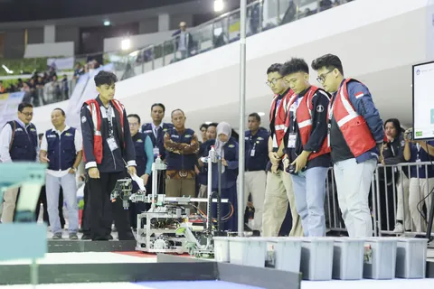
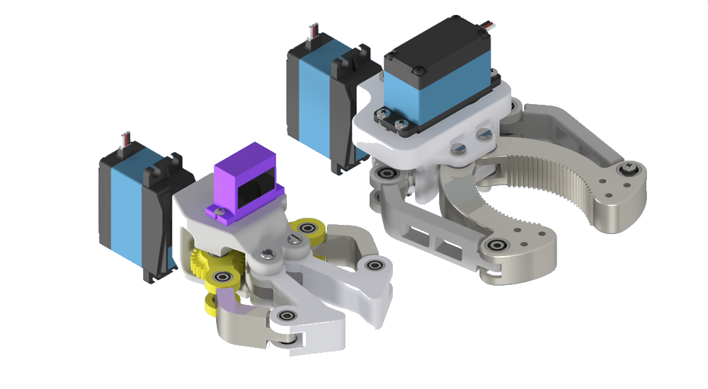
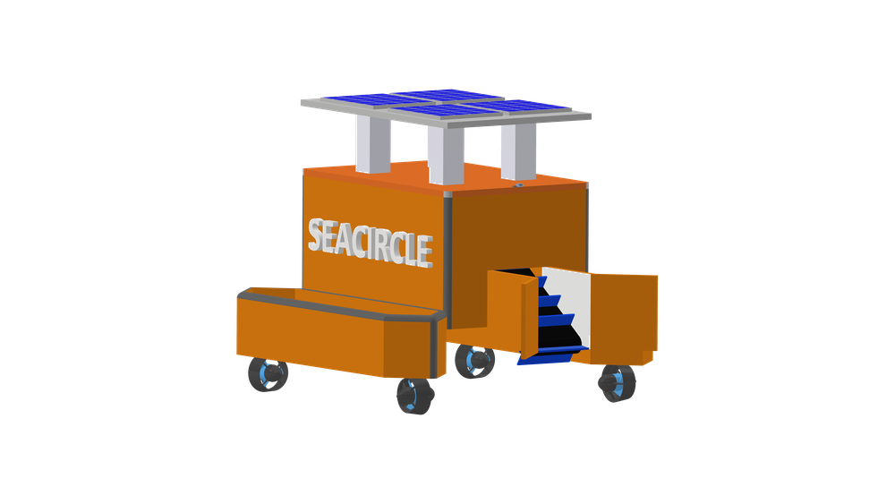
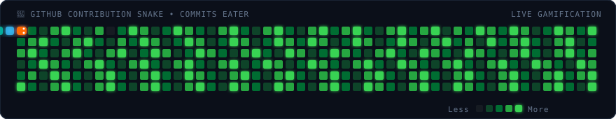

<div align="center">

  <p align="right">
    
  </p>

  <a href="https://triwahyu45.github.io/Portofolio/" target="_blank">
    
  </a>

  <a href="https://git.io/typing-svg">
    
  </a>

  <p>
    <a href="https://triwahyu45.github.io/Portofolio/"></a>
    <a href="https://abhinaya-uny.github.io/AbhinayaUNY_Web/"></a>
    <a href="https://www.linkedin.com/in/tri-wahyu-handoyo-a5a40026a/"></a>
    <a href="https://instagram.com/triwahyu45"></a>
    <a href="https://www.youtube.com/@TriWahyu45"></a>
    <a href="https://www.tiktok.com/@triwahyu45"></a>
    <a href="https://instagram.com/detronics.id"></a>
    <a href="https://linktr.ee/triwahyu45"></a>
    <a href="mailto:handoyotriwahyu@gmail.com"></a>
  </p>

</div>

---

## 💡 Tentang Saya

> *"Mengintegrasikan rekayasa mekanika presisi, sistem tertanam berkinerja tinggi, dan visi komputer cerdas untuk membangun robotika otonom yang tangguh."*

Halo! Saya **Tri Wahyu Handoyo**, mahasiswa S1 **Pendidikan Teknik Mekatronika** di **Universitas Negeri Yogyakarta (UNY)**, lulusan **SMK Negeri 3 Yogyakarta** (Teknik Audio Video). Saya **Lead Programmer** di Tim Robotika **Abhinaya UNY** (divisi KRTMI).

| Bidang | Yang saya kerjakan |
| :--- | :--- |
| 🤖 **Mobile Robotics** | Kinematika *4WD Mecanum* dan *Omni 3W/4W*, kendali PID loop tertutup, odometri gyro/IMU |
| 👁️ **Computer Vision & Edge AI** | Deteksi objek real-time dengan **YOLOv8/YOLOv11** dan **OpenCV** di embedded computer |
| ⚡ **Embedded & Firmware** | **STM32** (CubeIDE, Keil), **ESP32**, **Arduino** dengan C/C++ bare-metal dan RTOS |
| 📐 **3D CAD & Mekanik** | Sasis, transmisi, dan gripper di **Autodesk Inventor**, plus 3D printing |
| 🔌 **PCB & Hardware** | Skematik dan layout di **EAGLE** dan **KiCad**, simulasi **Proteus**, soldering standar IPC-610 |
| 🌐 **Web Simulators** | Simulator robotika interaktif (Three.js, HTML5 Canvas, Next.js) |

---

## 🏆 Pencapaian

| Prestasi | Ajang | Penyelenggara |
| :--- | :--- | :--- |
| 🥇 **Juara 1 Wilayah I** | KRTMI 2024 | Puspresnas Kemendikbudristek RI |
| 🥈 **Juara 2 Nasional** | KRTMI 2024 | Puspresnas Kemendikbudristek RI |
| 🏅 **Finalis Transporter Robot** | Technocorner 2024 / 2026 | KMTETI FT UGM |
| 🥇 **Juara 1 Esai Nasional** | INESCO 2025 | Universitas Muhammadiyah Purwokerto |
| 🥇 **Juara 1 National Essay** | HIMEPA 2025 | Universitas Tanjungpura |
| 🥈 **Juara 2 National Paper** | PANCO 2025 | Himpunan Mahasiswa Perkapalan |
| 🏅 **Kontingen Resmi** | KRI 2023 | Puspresnas Kemendikbudristek RI & USM |
| 👨‍🏫 **Pembimbing Elektronika & IoT** | LKS SMK (DIY) | Pelatih bidang mikrokontroler |

---

## 🤖 Robot & Desain CAD

<div align="center">

<table>
  <tr>
    <td width="50%" align="center">
      <a href="https://abhinaya-uny.github.io/AbhinayaUNY_Web/" target="_blank">
        <br>
        <b>🥇 Robot Otonom KRTMI</b>
      </a>
      <p align="left"><small>Juara 1 Wilayah I & Juara 2 Nasional KRTMI 2024. Robot pemilah sampah dengan 4WD Mecanum, YOLOv8, dan PID tertutup.</small></p>
      <code>Mecanum 4WD</code> • <code>YOLOv8</code> • <code>ESP32 / STM32</code>
    </td>
    <td width="50%" align="center">
      <a href="https://triwahyu45.github.io/Portofolio/#cad-3d-viewer" target="_blank">
        <br>
        <b>🦾 Robot Transporter (Technocorner UGM)</b>
      </a>
      <p align="left"><small>Finalis Technocorner. Drivetrain Mecanum, gripper lead-screw motorized, dual driver TB6612FNG, dan PID.</small></p>
      <code>Inventor</code> • <code>Mecanum 4W</code> • <code>Lead-Screw Gripper</code>
    </td>
  </tr>
  <tr>
    <td width="50%" align="center">
      <a href="https://triwahyu45.github.io/Portofolio/#cad-3d-viewer" target="_blank">
        <br>
        <b>🌾 Robot Inesco</b>
      </a>
      <p align="left"><small>Juara 1 Esai Nasional INESCO 2025. CAD robot pertanian cerdas untuk pemilahan dan pengangkutan hasil panen.</small></p>
      <code>Inventor</code> • <code>Agri-Robotics</code>
    </td>
    <td width="50%" align="center">
      <a href="https://triwahyu45.github.io/Portofolio/#cad-3d-viewer" target="_blank">
        <br>
        <b>💡 Robot Edukasi AI (FKMPI Fair)</b>
      </a>
      <p align="left"><small>Desain CAD untuk proposal karya tulis <i>Robot Analisis Pemahaman Siswa Berbasis AI</i>. Konsep 3D, bukan robot fisik.</small></p>
      <code>Inventor</code> • <code>3D CAD Assembly</code>
    </td>
  </tr>
</table>

</div>

---

## 🌐 Web Apps & Simulator

| Proyek | Live | Repo | Teknologi |
| :--- | :---: | :---: | :--- |
| **3D Interactive Portfolio** | [Buka](https://triwahyu45.github.io/Portofolio/) | [Kode](https://github.com/triwahyu45/Portofolio) | `Three.js` `WebGL` |
| **Portal Robotika Abhinaya UNY** | [Buka](https://abhinaya-uny.github.io/AbhinayaUNY_Web/) | [Kode](https://github.com/Abhinaya-UNY/AbhinayaUNY_Web) | `Next.js` `TypeScript` `Tailwind` |
| **Kinematics Wheels 2D** | [Buka](https://triwahyu45.github.io/Kinematics_Wheels/) | [Kode](https://github.com/triwahyu45/Kinematics_Wheels) | `Canvas` `Gamepad API` |
| **Simulasi Omni Technocorner 2026** | [Buka](https://triwahyu45.github.io/simulasi-omni-technocorner-2026/) | [Kode](https://github.com/triwahyu45/simulasi-omni-technocorner-2026) | `Canvas` `Vector Kinematics` |
| **ESP32 OLED Video Converter** | [Buka](https://triwahyu45.github.io/ESP32-OLED-Video-Converter/) | [Kode](https://github.com/triwahyu45/ESP32-OLED-Video-Converter) | `JS` `Bayer Dithering` |
| **Flex Sensor Simulator** | [Buka](https://triwahyu45.github.io/Flex-Sensor-Web-Simulator/) | [Kode](https://github.com/triwahyu45/Flex-Sensor-Web-Simulator) | `Canvas` `Web Audio` |
| **Gamepad Piano** | [Buka](https://triwahyu45.github.io/GamepadPiano/) | [Kode](https://github.com/triwahyu45/GamepadPiano) | `Web Audio` `Gamepad API` |
| **ToRayBan Meta Video Converter** | [Buka](https://triwahyu45.github.io/ToRayBan_Converter/) | [Kode](https://github.com/triwahyu45/ToRayBan_Converter) | `Next.js` `FFmpeg WASM` |
| **Judoru45 Anti-Gambling Simulator** | [Buka](https://triwahyu45.github.io/Judoru45_Game/) | [Kode](https://github.com/triwahyu45/Judoru45_Game) | `React` `TypeScript` |
| **Wahyu's Plan (Notion-style)** | [Buka](https://triwahyu45.github.io/Wahyus-Plan/) | [Kode](https://github.com/triwahyu45/Wahyus-Plan) | `React` `Tailwind` |

---

## ⚙️ Repositori Unggulan

| Proyek | Repo | Teknologi | Deskripsi |
| :--- | :---: | :--- | :--- |
| 🏎️ **Robotics NUC** | [Robotics_Nuc](https://github.com/triwahyu45/Robotics_Nuc) | `Python` `OpenCV` | Kontrol dan visi komputer untuk navigasi robot otonom |
| ⌚ **Redmi Watch 5 Active RE** | [RE_Redmi-Watch-5-Active](https://github.com/triwahyu45/RE_Redmi-Watch-5-Active) | `BLE` `Binary` | Reverse engineering firmware, protokol BLE, dan watchface `.bin` |
| 🐧 **UbRoid** | [UbRoid_TriWahyu45](https://github.com/triwahyu45/UbRoid_TriWahyu45) | `Linux` `Android` | Ubuntu di Android untuk development mobile |
| 🔊 **DetronicsID & QrisSound** | [DetronicsID](https://github.com/triwahyu45/DetronicsID) • [QrisSound](https://github.com/triwahyu45/QrisSound) | `ESP32` `IoT` | Modul IoT dan notifikasi suara transaksi QRIS |

---

## 🛠️ Tech Stack

<div align="center">

<a href="https://skillicons.dev">
  
</a>

<br><br>


</div>

<details>
<summary><b>🔧 Hardware & Toolchain lengkap</b></summary>
<br>

* **Mikrokontroler**: STM32F103C8T6 (BluePill), STM32F401/F411 (BlackPill), ESP32-S3, ESP32-WROOM, Arduino Mega 2560
* **IDE & Toolchain**: STM32CubeIDE, Keil uVision 5, Arduino IDE 2.x, VS Code, PlatformIO
* **Driver & Aktuator**: TB6612FNG, BTS7960 43A, servo MG996R / SG90, DC geared encoder motor
* **Sensor**: Kamera USB/CSI, AS5600, MPU6050, VL53L0X, ultrasonik
* **CAD & Manufaktur**: Autodesk Inventor, AutoCAD, 3D printing (Cura / Bambu Studio)
* **PCB**: EAGLE, KiCad, Proteus, THT & SMD (IPC-610)

</details>

<details>
<summary><b>🤖 Kinematika Mecanum 4WD (rumus invers)</b></summary>
<br>

Memetakan kecepatan translasi \((v_x, v_y)\) dan angular \((\omega_z)\) ke kecepatan tiap roda:

```math
\begin{bmatrix} \omega_1 \\ \omega_2 \\ \omega_3 \\ \omega_4 \end{bmatrix}
=
\frac{1}{R}
\begin{bmatrix}
1 & -1 & -(L_x + L_y) \\
1 &  1 &  (L_x + L_y) \\
1 &  1 & -(L_x + L_y) \\
1 & -1 &  (L_x + L_y)
\end{bmatrix}
\begin{bmatrix} v_x \\ v_y \\ \omega_z \end{bmatrix}
```

* **Holonomik 3-DOF**: bergerak ke segala arah tanpa memutar sasis
* **PID 100 Hz**: interupsi timer hardware pada STM32/ESP32
* **Gyro odometry**: yaw MPU6050 DMP untuk gerak *field-centric*

</details>

---

## 📈 GitHub Stats

<div align="center">

<p>
  
  
</p>



</div>

---

## 💖 Dukung Riset Saya

Kalau simulator, model CAD, atau repo saya bermanfaat, dukungan untuk riset modul mikrokontroler dan komponen hardware bisa disalurkan lewat:

<div align="center">

<a href="https://sociabuzz.com/triwahyu45/tribe"></a>
<a href="https://saweria.co/triwahyu45"></a>
<a href="https://trakteer.id/triwahyu45"></a>

<br><br>


</div>
